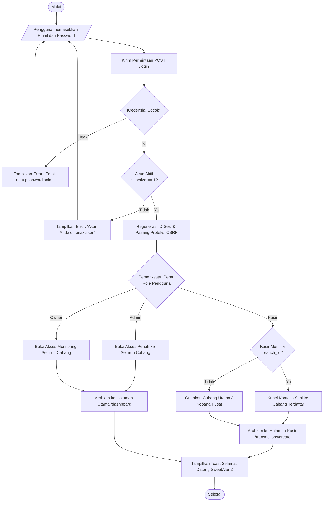
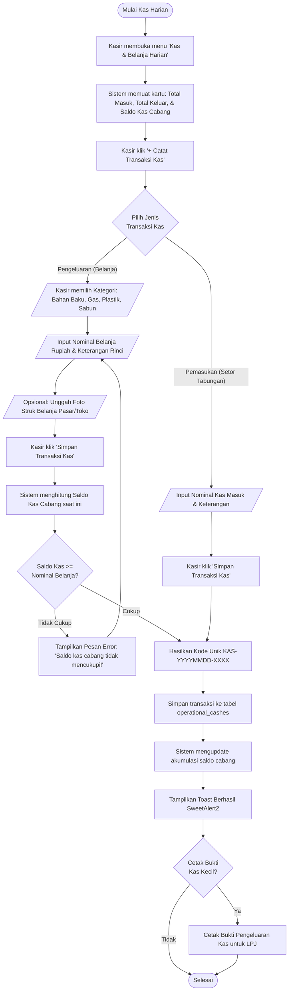
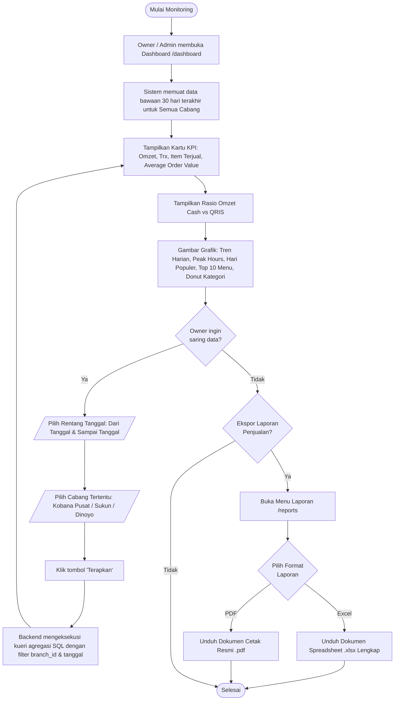
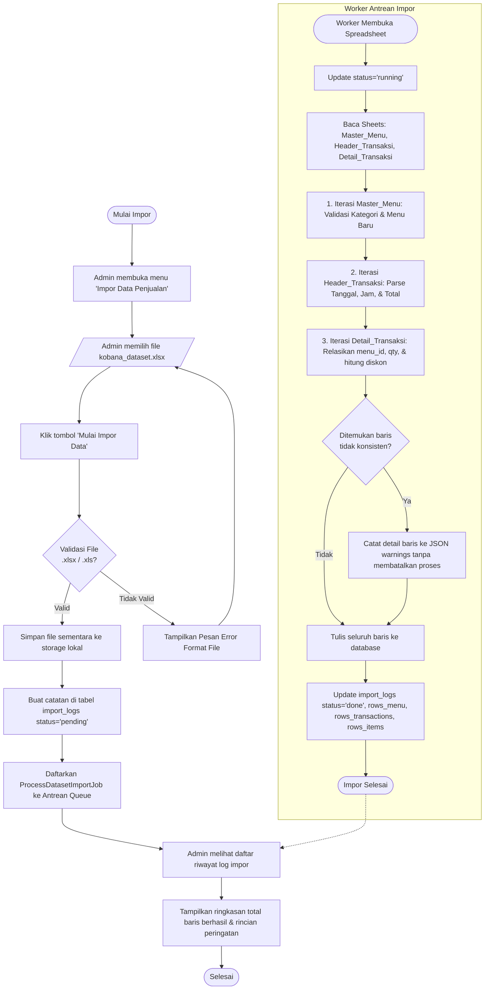

# 📊 Activity Diagram (Diagram Aktivitas)
## Pemodelan Alur Kerja & Logika Proses Bisnis Sistem POS
### Kobana Fried Chicken

---

## 1. Pendahuluan

*Activity Diagram* (Diagram Aktivitas) menggambarkan aspek dinamis dari sistem dengan memodelkan urutan langkah, percabangan keputusan (*decision points*), pemrosesan paralel (*fork & join*), serta pembagian tanggung jawab antar aktor dan sistem menggunakan jalur aktivitas (*swimlanes*).

Dokumen ini memuat diagram aktivitas untuk 7 proses inti pada sistem **Kobana POS & Analisis FP-Growth**:
1. **AD-01**: Autentikasi Pengguna & Penentuan Akses Cabang
2. **AD-02**: Transaksi Penjualan Kasir POS — Pembayaran Tunai (Cash)
3. **AD-03**: Transaksi Penjualan Kasir POS — Pembayaran QRIS & Kamera Bukti
4. **AD-04**: Pengelolaan Kas Kecil & Belanja Harian Warung
5. **AD-05**: Pipeline Komputasi Data Mining FP-Growth
6. **AD-06**: Monitoring Dasbor Analitik & Filter Cabang
7. **AD-07**: Impor Massal Dataset Penjualan Excel

---

## 2. AD-01: Autentikasi Pengguna & Penentuan Akses Cabang

Diagram ini memodelkan proses verifikasi identitas, pemeriksaan status aktif pengguna, serta penguncian konteks cabang toko.



---

## 3. AD-02: Transaksi Penjualan Kasir POS — Pembayaran Tunai (Cash)

Diagram ini memodelkan alur pelayanan pelanggan di meja kasir dengan metode pembayaran uang tunai, kalkulasi kembalian otomatis, dan pencetakan nota.

```mermaid
flowchart TD
    START([Mulai Transaksi]) --> OPEN_POS[Kasir membuka layar POS /transactions/create]
    OPEN_POS --> SHOW_MENU[Sistem memuat daftar menu aktif & info cabang]
    SHOW_MENU --> SEARCH_MENU[/Kasir mencari menu via input pencarian/]
    SEARCH_MENU --> SELECT_ITEM[Kasir menentukan Qty & Diskon per item]
    SELECT_ITEM --> CLICK_ADD[Kasir klik tombol '+ Tambah']

    CLICK_ADD --> UPDATE_CART[Sistem menambahkan item ke tabel Keranjang]
    UPDATE_CART --> CALC_TOTAL[Hitung Total Item & Total Bayar Bersih]
    CALC_TOTAL --> MORE_ITEMS{Tambah menu<br/>lainnya?}

    MORE_ITEMS -- Ya --> SEARCH_MENU
    MORE_ITEMS -- Tidak --> CHOOSE_CASH[Pilih Metode Pembayaran: 'Cash']

    CHOOSE_CASH --> INPUT_CASH[/Kasir menginput Uang Tunai Diterima<br/>atau klik tombol cepat 20rb/50rb/100rb/]
    INPUT_CASH --> CALC_CHANGE[Sistem menghitung Kembalian secara real-time]
    CALC_CHANGE --> CHK_CASH{Uang Diterima >=<br/>Total Bayar?}

    CHK_CASH -- Tidak --> WARN_LESS[Indikator Merah: Uang Kurang & Tombol Simpan Disabled]
    WARN_LESS --> INPUT_CASH

    CHK_CASH -- Ya --> SHOW_CHANGE[Tampilkan Nominal Kembalian Hijau & Aktifkan Tombol Simpan]
    SHOW_CHANGE --> CLICK_SUBMIT[Kasir klik 'Proses & Simpan Transaksi']

    CLICK_SUBMIT --> SWAL_CONFIRM{Konfirmasi Modal<br/>SweetAlert2}
    SWAL_CONFIRM -- Batal --> INPUT_CASH
    SWAL_CONFIRM -- Ya, Simpan --> START_DB_TRX[Sistem membuka DB::transaction]

    START_DB_TRX --> LOCK_SEQ[Kunci baris tanggal di transaction_sequences]
    LOCK_SEQ --> GEN_CODE[Hasilkan Kode Unik TRXYYYYMMDDXXXXX]
    GEN_CODE --> SAVE_HEADER[Simpan ke tabel transactions]
    SAVE_HEADER --> SAVE_ITEMS[Simpan setiap baris ke tabel transaction_items]
    SAVE_ITEMS --> COMMIT_TRX[Commit Transaksi Database]

    COMMIT_TRX --> REDIR_SHOW[Arahkan ke Rincian Nota /transactions/{id}]
    REDIR_SHOW --> PRINT_PROMPT{Kasir ingin<br/>cetak struk?}

    PRINT_PROMPT -- Ya --> TRIGGER_PRINT[Jalankan window.print untuk Printer Thermal]
    PRINT_PROMPT -- Tidak --> END([Selesai])
    TRIGGER_PRINT --> END
```

---

## 4. AD-03: Transaksi Kasir POS — Pembayaran QRIS & Kamera Bukti

Diagram ini memodelkan penanganan pembayaran digital QRIS yang dilengkapi fitur penangkap kamera peramban (*webcam / mobile camera*) untuk merekam bukti transaksi berhasil.

```mermaid
flowchart TD
    START([Mulai Transaksi QRIS]) --> OPEN_POS[Kasir mengisi Keranjang Belanja]
    OPEN_POS --> CHOOSE_QRIS[Kasir memilih opsi pembayaran 'QRIS']
    CHOOSE_QRIS --> HIDE_CASH[Sistem menyembunyikan panel tunai & menampilkan panel QRIS]
    HIDE_CASH --> SHOW_QR_STATIC[Kasir menunjukkan kode QRIS Kobana ke Pelanggan]

    SHOW_QR_STATIC --> CUST_SCAN[/Pelanggan memindai QRIS & melakukan pembayaran di HP/]
    CUST_SCAN --> INPUT_REF[/Kasir memasukkan No. Referensi / RRN struk QRIS opsional/]

    INPUT_REF --> CHOOSE_CAPTURE_METHOD{Pilih Metode<br/>Bukti Bayar}

    %% Cabang Kamera Langsung
    CHOOSE_CAPTURE_METHOD -- Kamera Langsung --> CLICK_OPEN_CAM[Kasir klik tombol 'Buka Kamera']
    CLICK_OPEN_CAM --> REQ_STREAM[Sistem panggil navigator.mediaDevices.getUserMedia]
    REQ_STREAM --> PERM_CHECK{Izin Kamera<br/>Diberikan?}

    PERM_CHECK -- Ditolak / Tidak Ada --> SHOW_CAM_ERR[Tampilkan Peringatan: Gunakan Tombol Unggah File]
    SHOW_CAM_ERR --> CLICK_PICK_FILE

    PERM_CHECK -- Diterima --> PLAY_VIDEO[Aktifkan elemen video streaming langsung]
    PLAY_VIDEO --> AIM_CAMERA[Kasir mengarahkan kamera ke layar HP pelanggan]
    AIM_CAMERA --> CLICK_SNAP[Kasir klik 'Ambil Foto']
    CLICK_SNAP --> DRAW_CANVAS[Sistem merender frame video ke elemen canvas HTML5]
    DRAW_CANVAS --> EXPORT_BASE64[Konversi canvas ke dataURL JPEG 85%]
    EXPORT_BASE64 --> STOP_CAM[Hentikan semua track stream kamera]
    STOP_CAM --> SET_PREVIEW[Tampilkan gambar pada kartu pratinjau 'Foto Siap']

    %% Cabang Unggah Screenshot
    CHOOSE_CAPTURE_METHOD -- Unggah Screenshot --> CLICK_PICK_FILE[Kasir klik tombol 'Unggah File']
    CLICK_PICK_FILE --> SELECT_IMAGE_FILE[/Kasir memilih file gambar screenshot/]
    SELECT_IMAGE_FILE --> READ_FILE_READER[FileReader membaca file ke DataURL]
    READ_FILE_READER --> SET_PREVIEW

    SET_PREVIEW --> CHECK_PHOTO_OK{Kasir puas<br/>dengan foto?}
    CHECK_PHOTO_OK -- Ambil Ulang --> CLICK_DELETE_PROOF[Kasir klik 'Hapus']
    CLICK_DELETE_PROOF --> CHOOSE_CAPTURE_METHOD

    CHECK_PHOTO_OK -- Ya, Lanjut --> CLICK_SAVE_TRX[Kasir klik 'Proses & Simpan Transaksi']
    CLICK_SAVE_TRX --> POPUP_CONFIRM[Dialog Konfirmasi SweetAlert2]
    POPUP_CONFIRM --> SEND_POST[Kirim Form dengan Base64 / File Multipart]

    SEND_POST --> HANDLE_PROOF_BACKEND[Backend TransactionController::handlePaymentProof]
    HANDLE_PROOF_BACKEND --> WRITE_STORAGE[Simpan file ke storage/app/public/payment_proofs/]
    WRITE_STORAGE --> DB_ATOMIC[Jalankan DB::transaction dengan Row-Locking]
    DB_ATOMIC --> SAVE_TRX_QRIS[Simpan Transaction dengan kolom payment_proof terisi]
    SAVE_TRX_QRIS --> REDIR_DETAIL[Arahkan ke Nota Detail]
    REDIR_DETAIL --> SHOW_LIGHTBOX[Tampilkan kartu Bukti QRIS + Tombol Perbesar Foto]
    SHOW_LIGHTBOX --> END([Selesai])
```



---

## 5. AD-04: Pengelolaan Kas Kecil & Belanja Harian Warung

Diagram ini memodelkan proses pencatatan belanja kebutuhan dapur warung (beras, gas LPG, minyak goreng, kantong kresek, teh/gula, sabun) serta setoran tabungan hasil penjualan harian.



---

## 6. AD-05: Pipeline Komputasi Data Mining FP-Growth

Diagram ini memodelkan proses penambangan aturan asosiasi keranjang belanja secara asinkron menggunakan pohon *FP-Tree* pada ribuan transaksi.

```mermaid
flowchart TD
    START([Mulai Analisis]) --> OPEN_FP[Owner / Admin membuka menu 'Analisis FP-Growth']
    OPEN_FP --> INPUT_PARAMS[/Input Judul Sesi, Tanggal Awal & Akhir, Min Support %, Min Confidence %/]
    INPUT_PARAMS --> CLICK_RUN[Klik 'Mulai Analisis']

    CLICK_RUN --> CREATE_PENDING_RECORD[Sistem membuat record di tabel fp_analyses status='pending']
    CREATE_PENDING_RECORD --> DISPATCH_JOB[Kirim RunFpGrowthJob ke Antrean Queue Database]
    DISPATCH_JOB --> FLASH_MSG[Tampilkan Notifikasi: 'Analisis berjalan di antrean latar belakang']

    subgraph Background_Queue_Worker [Pekerja Latar Belakang (Queue Worker)]
        START_WORKER([Worker Mengambil Job]) --> SET_RUNNING[Update status='running', started_at=NOW]
        SET_RUNNING --> QUERY_TRX[Ambil data transaksi & detail item pada rentang tanggal]
        QUERY_TRX --> CHK_TRX_EXIST{Transaksi<br/>Ditemukan?}

        CHK_TRX_EXIST -- Tidak Ada Data --> SET_FAILED[Update status='failed' dengan pesan error]
        SET_FAILED --> END_WORKER([Job Gagal])

        CHK_TRX_EXIST -- Ada Data --> CALC_1_ITEMSET[1. Hitung Frekuensi Kemunculan Tiap Menu 1-Itemset]
        CALC_1_ITEMSET --> PRUNE_MIN_SUPP[2. Eliminasi Menu dengan Support < Min Support]
        PRUNE_MIN_SUPP --> SORT_TRANSACTIONS[3. Urutkan Menu dalam Tiap Keranjang secara Descending]
        SORT_TRANSACTIONS --> BUILD_FPTREE[4. Bangun FP-Tree & Hubungkan Header Table Linked-List]
        BUILD_FPTREE --> MINE_TREE[5. Rekursi Penambangan Conditional FP-Tree untuk Pola Majemuk]
        MINE_TREE --> EXTRACT_FREQUENT[6. Ekstraksi Daftar Frequent Itemsets]
        EXTRACT_FREQUENT --> SAVE_ITEMSETS[Simpan ke tabel fp_frequent_itemsets]

        SAVE_ITEMSETS --> GEN_RULES[7. Bentuk Aturan Asosiasi X -> Y yang Memenuhi Min Confidence]
        GEN_RULES --> CALC_LIFT[8. Hitung Nilai Korelasi Lift Ratio]
        CALC_LIFT --> FILTER_LIFT[9. Filter Aturan Signifikan Lift > 1.0]
        FILTER_LIFT --> SAVE_RULES[Simpan ke tabel fp_association_rules]

        SAVE_RULES --> SET_DONE[Update status='done', finished_at=NOW, total_transactions]
        SET_DONE --> END_WORKER_OK([Job Sukses Selesai])
    end

    FLASH_MSG --> POLL_OR_REFRESH[/Owner membuka rincian hasil analisis/]
    END_WORKER_OK -.-> POLL_OR_REFRESH
    POLL_OR_REFRESH --> RENDER_RESULTS[Sistem menyajikan tabel Frequent Itemsets & Rekomendasi Menu Bundling]
    RENDER_RESULTS --> END([Selesai])
```

---

## 7. AD-06: Monitoring Dasbor Analitik & Filter Cabang

Diagram ini memodelkan proses eksplorasi performa operasional dan finansial penjualan lintas cabang oleh Owner dan Admin.



---

## 8. AD-07: Impor Massal Dataset Penjualan Excel

Diagram ini memodelkan proses pemuatan ribuan baris data penjualan historis melalui berkas spreadsheet.


