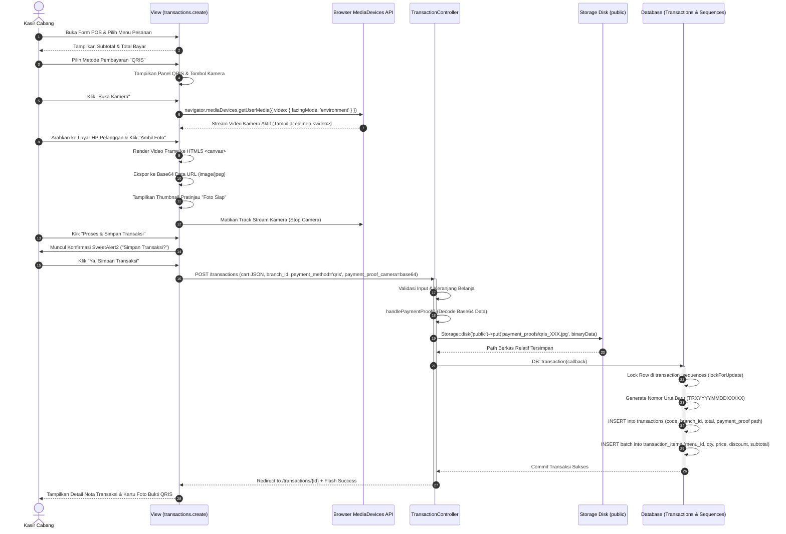
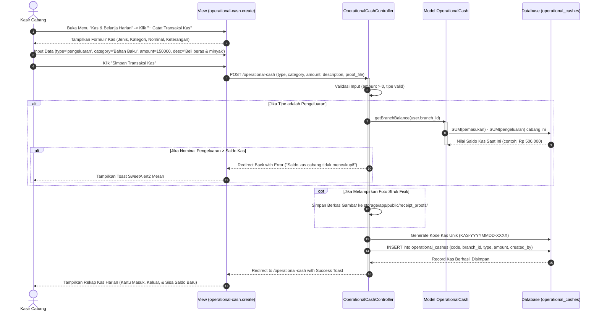
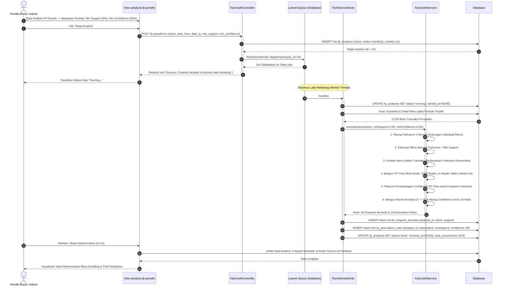

# 🏗️ Arsitektur Sistem & Diagram Sekuensial
## Desain Perangkat Lunak & Alur Interaksi Komponen
### Kobana Fried Chicken

---

## 1. Arsitektur Perangkat Lunak Tingkat Tinggi (*High-Level Architecture*)

Sistem Kobana POS dirancang menggunakan arsitektur berlapis (*Layered Architecture*) berbasis pola **Model-View-Controller (MVC)** dari Laravel 13, dipadukan dengan pemrosesan antrean asinkron (*Background Queue Processing*) dan akses perangkat keras antarmuka browser bawaan (*Native HTML5 Hardware APIs*).

```mermaid
flowchart TD
    subgraph Presentation_Layer [Lapisan Presentasi (Client-Side)]
        BROWSER["Peramban Web (Desktop / Laptop / Mobile / Tablet)"]
        UI_FRAMEWORK["Bootstrap 5.3.3 + Icons (CDN - No Build Step)"]
        UI_NOTIF["SweetAlert2 (CDN Toast & Dialog Konfirmasi)"]
        UI_CHART["Chart.js 4 (CDN Grafik Interaktif Dashboard)"]
        UI_CAMERA["HTML5 MediaDevices API & Canvas (Akses Kamera Langsung)"]
    end

    subgraph Application_Layer [Lapisan Aplikasi & Kontroler (Server-Side)]
        ROUTER["Laravel Routing (web.php)"]
        MIDDLEWARE["Middleware (Auth, RoleMiddleware: admin|kasir|owner)"]
        
        subgraph Controllers [Controllers]
            C_AUTH["AuthController"]
            C_POS["TransactionController"]
            C_CASH["OperationalCashController"]
            C_DASH["DashboardController"]
            C_MENU["MenuController & CategoryController"]
            C_USER["UserController & BranchController"]
            C_REPORT["ReportController"]
            C_FP["FpGrowthController"]
            C_IMPORT["ImportController"]
        end
    end

    subgraph Business_Service_Layer [Lapisan Logika Bisnis & Servis]
        S_FP["FpGrowthService (FP-Tree Construction & Rule Mining)"]
        S_IMPORT["DatasetImportService (Spreadsheet Parser & Validator)"]
        S_EXPORT["ReportExportService (Excel / DomPDF Exporter)"]
    end

    subgraph Background_Queue_Layer [Lapisan Antrean Latar Belakang]
        Q_DB["Database Queue Driver (Tabel: jobs, failed_jobs)"]
        JOB_FP["RunFpGrowthJob"]
        JOB_IMPORT["ProcessDatasetImportJob"]
    end

    subgraph Persistence_Layer [Lapisan Persistensi & Data]
        ORM["Eloquent ORM (Models & Relationships)"]
        DB[("Relational Database (MySQL 8 / MariaDB / SQLite)")]
        STORAGE[("Local Public Storage (storage/app/public/payment_proofs/)")]
    end

    %% Relasi Aliran
    BROWSER --> ROUTER
    UI_CAMERA -.->|Stream Gambar Base64 / File| C_POS
    ROUTER --> MIDDLEWARE
    MIDDLEWARE --> Controllers

    C_POS --> ORM
    C_POS --> STORAGE
    C_CASH --> ORM
    C_CASH --> STORAGE
    C_DASH --> ORM
    C_MENU --> ORM
    C_USER --> ORM
    C_REPORT --> S_EXPORT
    
    C_FP --> JOB_FP
    C_IMPORT --> JOB_IMPORT
    
    JOB_FP --> Q_DB
    JOB_IMPORT --> Q_DB
    Q_DB --> S_FP & S_IMPORT
    
    S_FP --> ORM
    S_IMPORT --> ORM
    S_EXPORT --> ORM

    ORM <--> DB
```

---

## 2. Diagram Sekuensial (*Sequence Diagrams*)

### 2.1 Sekuensial 1: Transaksi Kasir POS dengan Pembayaran QRIS & Kamera Bukti

Diagram ini menggambarkan alur detail komunikasi dari saat kasir mengaktifkan kamera laptop/HP, memotret bukti berhasil transaksi QRIS pelanggan, hingga penyimpanan atomik ke database dan penyimpanan berkas bukti ke disk.



---

### 2.2 Sekuensial 2: Pencatatan Kas Operasional Harian & Saldo Kas Warung

Diagram ini menggambarkan alur pencatatan belanja harian warung (beras, gas, minyak, sabun) beserta validasi batas saldo kas cabang.



---

### 2.3 Sekuensial 3: Pipeline Algoritma FP-Growth (Data Mining Keranjang Belanja)

Diagram ini menggambarkan proses komputasi data mining dari inisiasi oleh Owner hingga pembentukan aturan asosiasi menu bundling.



---

## 3. Pemetaan Direktori & Komponen Kode (*Component Mapping*)

Untuk memudahkan navigasi arsitektur dan penelusuran kode, berikut adalah pemetaan komponen utama dalam repositori:

| Modul / Domain | Model Eloquent | Kontroler Utama | Views (Blade Templates) | Migrasi Database |
|---|---|---|---|---|
| **Multi-Cabang** | `app/Models/Branch.php` | Diintegrasikan ke Transaksi & User | Komponen Header & Dropdown | `2026_04_03_000001_create_branches...` |
| **Pengguna & Akses**| `app/Models/User.php` | `app/Http/Controllers/UserController.php` | `resources/views/users/` | `0001_01_01_000000_create_users_table.php` |
| **Katalog Menu** | `app/Models/Menu.php`, `Category.php` | `MenuController.php`, `CategoryController.php` | `resources/views/menus/`, `categories/` | `2026_04_01_000001_create_menus_and_categories...` |
| **POS & QRIS Kamera**| `app/Models/Transaction.php`, `TransactionItem.php`| `app/Http/Controllers/TransactionController.php` | `resources/views/transactions/` | `2026_04_01_000002_create_transactions...`, `...add_payment_proof...` |
| **Kas & Belanja Warung**| `app/Models/OperationalCash.php` | `app/Http/Controllers/OperationalCashController.php`| `resources/views/operational-cash/` | `2026_04_04_000001_create_operational_cashes...` |
| **Analisis FP-Growth**| `FpAnalysis.php`, `FpFrequentItemset.php`, `FpAssociationRule.php` | `app/Http/Controllers/FpGrowthController.php` | `resources/views/analysis/` | `2026_04_01_000003_create_fp_tables...` |
| **Dasbor Analitik** | Multi-Model Aggregation | `app/Http/Controllers/DashboardController.php` | `resources/views/dashboard/` | Menggunakan agregasi database kueri |
| **Laporan & Ekspor** | Multi-Model Aggregation | `app/Http/Controllers/ReportController.php` | `resources/views/reports/` | Format cetak Blade PDF & Excel |
| **Pengujian Fitur** | - | - | - | `tests/Feature/BranchAndPaymentTest.php`, `OperationalCashTest.php`, dll |
