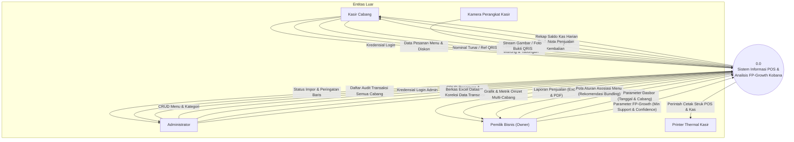
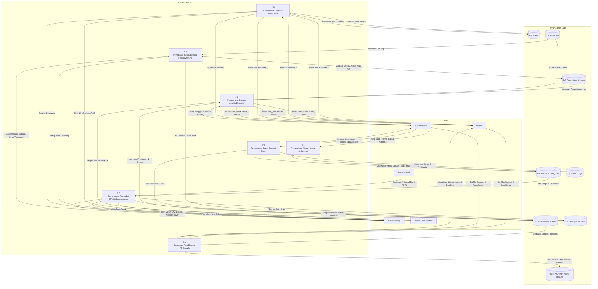
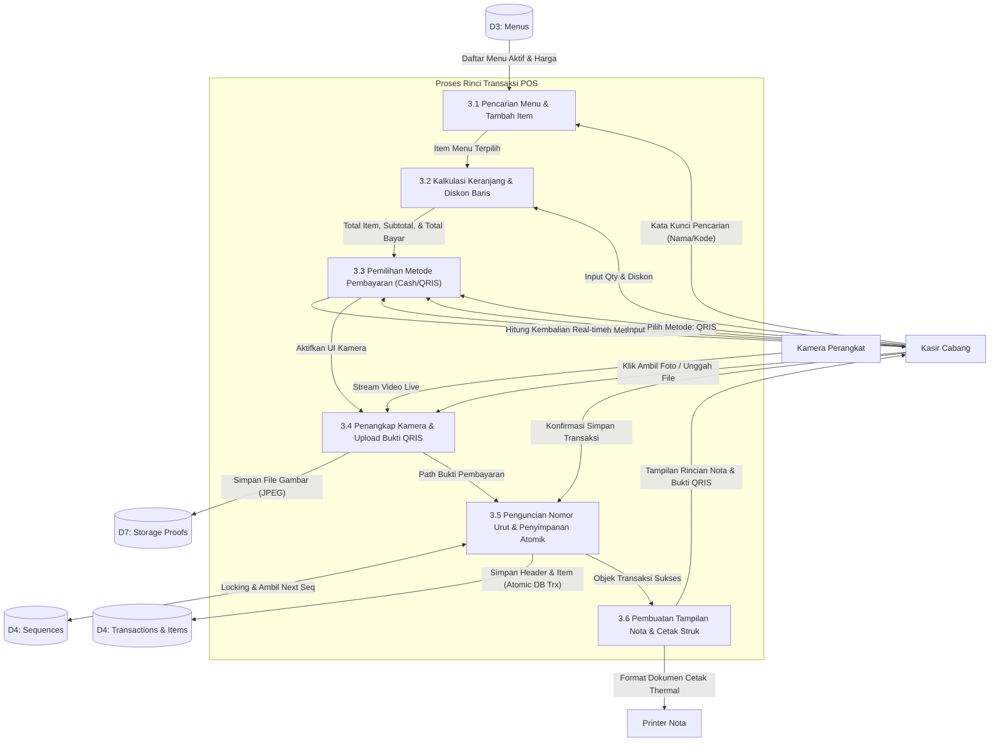
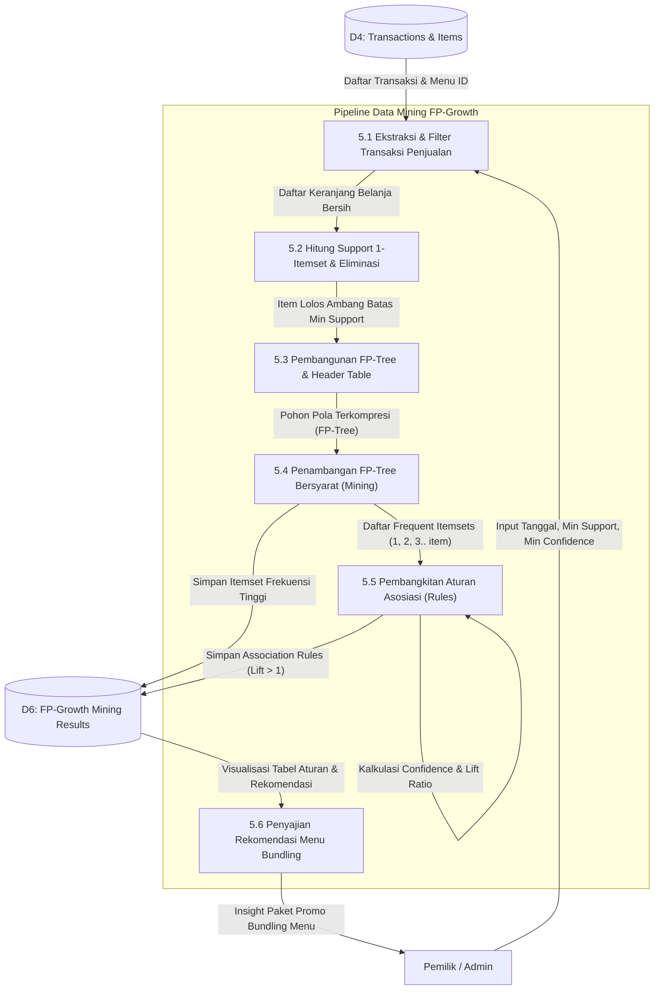

# 🔄 Data Flow Diagram (DFD)
## Diagram Aliran Data Sistem POS & Analisis Keranjang Belanja FP-Growth
### Kobana Fried Chicken

---

## 1. Notasi & Entitas Sistem

Diagram Aliran Data (*Data Flow Diagram* / DFD) memetakan transformasi data di dalam sistem, mulai dari input pengguna, proses bisnis, penyimpanan data (*data store*), hingga keluaran informasi (*output*).

### 1.1 Entitas Luar (*External Entities*)
1. **Kasir Cabang**: Petugas kasir di outlet fisik (Kobana Pusat, Sukun, Dinoyo) yang memasukkan pesanan, memproses pembayaran, mengambil foto bukti QRIS, dan mencatat kas belanja warung.
2. **Administrator**: Pengelola operasional toko yang mengelola master menu/kategori, hak akses user, impor dataset, dan perbaikan data transaksi.
3. **Pemilik Bisnis (*Owner*)**: Pimpinan eksekutif yang memantau performa penjualan seluruh cabang, membaca laporan, dan memanfaatkan analisis rekomendasi menu FP-Growth.
4. **Pelanggan (*Customer*)**: Konsumen yang melakukan pemesanan dan pembayaran (tunai atau kode QRIS).
5. **Kamera Perangkat Kasir (*Camera / Scanner Input*)**: Perangkat keras penangkap gambar (webcam PC atau kamera HP) untuk merekam bukti transaksi QRIS.
6. **Printer Thermal Kasir / Storage Berkas**: Perangkat cetak nota fisik dan sistem penyimpanan berkas bukti transaksi.

### 1.2 Penyimpanan Data (*Data Stores*)
- **D1: `users`** (Akun, Peran, & Penugasan Cabang)
- **D2: `branches`** (Identitas Outlet Cabang)
- **D3: `menus` & `categories`** (Katalog Produk & Kategori)
- **D4: `transactions` & `transaction_items`** (Arsip Penjualan POS)
- **D5: `operational_cashes`** (Arsip Kas Kecil & Tabungan Harian)
- **D6: `fp_analyses`, `fp_frequent_itemsets`, `fp_association_rules`** (Hasil Data Mining)
- **D7: `storage/app/public/`** (Berkas Fisik Foto Bukti Bayar & Struk)
- **D8: `import_logs`** (Catatan Jejak Audit Impor)

---

## 2. DFD Level 0 — Diagram Konteks (*Context Diagram*)

Diagram konteks menggambarkan sistem sebagai satu proses tunggal yang berinteraksi dengan entitas luar.



---

## 3. DFD Level 1 — Dekomposisi Sistem Utama

DFD Level 1 menguraikan sistem menjadi 7 sub-proses utama dan interaksinya dengan *Data Store*.



---

## 4. DFD Level 2 — Rincian Proses Kritis

### 4.1 Dekomposisi Proses 3.0: Pemrosesan Transaksi POS & Pembayaran QRIS Kamera

Diagram ini membedah alur detail saat kasir melayani transaksi di meja kasir.



---

### 4.2 Dekomposisi Proses 4.0: Pencatatan Kas & Belanja Harian Warung

Menjelaskan alur pencatatan kas kecil belanja kebutuhan operasional (beras, minyak, gas LPG, plastik) dan setoran tabungan harian.

```mermaid
flowchart TD
    subgraph P4_Subprocesses [Proses Rinci Kas Warung]
        P41["4.1 Penerimaan Formulir Kas Harian"]
        P42["4.2 Validasi Kecukupan Saldo Cabang"]
        P43["4.3 Pemrosesan Foto Struk Fisik Belanja"]
        P44["4.4 Pencatatan Transaksi Kas Kecil"]
        P45["4.5 Rekalkulasi Buku Kas & Saldo Cabang"]
    end

    KASIR["Kasir Cabang"]
    STORE_CASH[("D5: Operational Cashes")]
    STORE_IMG[("D7: Storage Struk")]
    PRINTER["Printer Nota Kas"]

    KASIR -->|"Jenis (Pengeluaran/Pemasukan), Nominal, Ket"| P41
    P41 -->|"Cek Saldo untuk Pengeluaran"| P42
    STORE_CASH -->|"Total Masuk vs Total Keluar Saat Ini"| P42
    
    P42 -- "Saldo Tidak Cukup" -->|"Peringatan: Saldo Kas Kurang"| KASIR
    P42 -- "Saldo Cukup / Pemasukan" --> P43

    KASIR -->|"Foto Struk Nota Pembelian (Opsional)"| P43
    P43 -->|"Tulis File Struk"| STORE_IMG
    P43 -->|"Data Valid & Path Struk"| P44

    P44 -->|"Simpan Record Kas (KAS-YYYYMMDD-XXXX)"| STORE_CASH
    P44 --> P45

    STORE_CASH -->|"Agregasi Seluruh Transaksi Hari Ini"| P45
    P45 -->|"Kartu Saldo Masuk, Keluar & Sisa Kas"| KASIR
    P45 -->|"Cetak Tanda Terima Kas Kecil"| PRINTER
```

---

### 4.3 Dekomposisi Proses 5.0: Pipeline Algoritma FP-Growth

Menggambarkan tahapan analisis asosiasi menu keranjang belanja.


