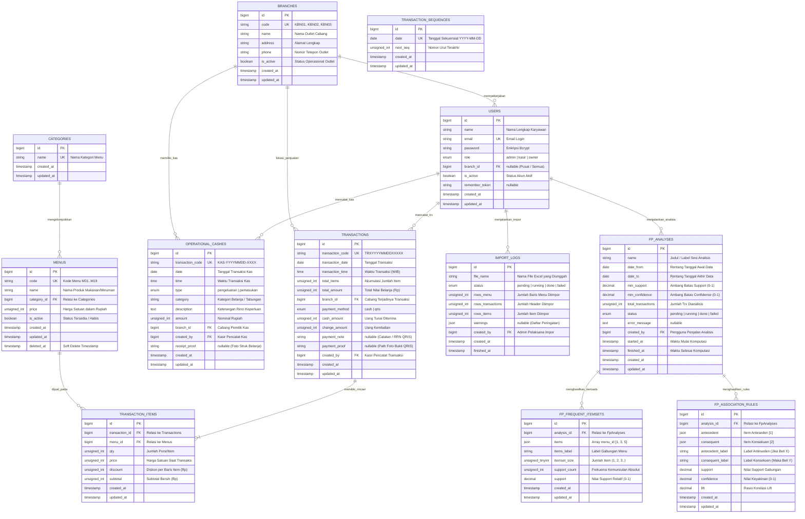

# 🗄️ Entity Relationship Diagram (ERD) & Kamus Data
## Perancangan Basis Data Terpadu Multi-Cabang
### Kobana Fried Chicken

---

## 1. Pemodelan Data Konseptual

Basis data dirancang untuk mendukung operasional multi-cabang terintegrasi (*multi-store architecture*) yang menghubungkan:
1. **Entitas Organisasi & Pengguna:** Cabang toko (`branches`) dan Pengguna sistem (`users`).
2. **Entitas Katalog Menu:** Kategori (`categories`) dan Master Menu (`menus`) yang mendukung penghapusan aman (*Soft Deletes*).
3. **Entitas Transaksi POS:** Header penjualan (`transactions`), Baris item penjualan (`transaction_items`), serta Nomor urut transaksi harian (`transaction_sequences`).
4. **Entitas Kas Operasional Harian:** Kas kecil belanja warung dan setoran tabungan harian (`operational_cashes`).
5. **Entitas Data Mining FP-Growth:** Parameter sesi analisis (`fp_analyses`), Itemset sering muncul (`fp_frequent_itemsets`), dan Aturan asosiasi menu (`fp_association_rules`).
6. **Entitas Log Integrasi:** Riwayat impor massal dataset Excel (`import_logs`).

---

## 2. Diagram ERD (Mermaid Diagram)

---

## 3. Kamus Data Rinci (*Data Dictionary*)

### 3.1 Tabel: `branches` (Master Cabang Toko)
Menyimpan informasi outlet resmi Kobana Fried Chicken.

| Nama Kolom | Tipe Data | Nullable | Bawaan | Keterangan |
|---|---|:---:|:---:|---|
| `id` | BIGINT UNSIGNED | Tidak | Auto Inc | Primary Key. |
| `code` | VARCHAR(20) | Tidak | - | Kode unik cabang (contoh: `KBN01`, `KBN02`, `KBN03`). |
| `name` | VARCHAR(100) | Tidak | - | Nama resmi cabang (contoh: *Kobana Pusat*, *Kobana Sukun*). |
| `address` | VARCHAR(255) | Ya | NULL | Alamat fisik lokasi cabang. |
| `phone` | VARCHAR(30) | Ya | NULL | Nomor kontak operasional cabang. |
| `is_active` | BOOLEAN | Tidak | 1 | Status cabang aktif atau nonaktif. |
| `created_at` | TIMESTAMP | Ya | NULL | Waktu pembuatan baris data. |
| `updated_at` | TIMESTAMP | Ya | NULL | Waktu terakhir data diubah. |

---

### 3.2 Tabel: `users` (Pengguna & Hak Akses)
Menyimpan akun pengguna sistem beserta peran dan penugasan cabangnya.

| Nama Kolom | Tipe Data | Nullable | Bawaan | Keterangan |
|---|---|:---:|:---:|---|
| `id` | BIGINT UNSIGNED | Tidak | Auto Inc | Primary Key. |
| `name` | VARCHAR(255) | Tidak | - | Nama lengkap pengguna / kasir. |
| `email` | VARCHAR(255) | Tidak | - | Alamat email unik untuk otentikasi login. |
| `password` | VARCHAR(255) | Tidak | - | Kata sandi yang di-hash menggunakan algoritma Bcrypt. |
| `role` | ENUM('admin','kasir','owner') | Tidak | 'kasir' | Hak akses tingkat otorisasi sistem. |
| `branch_id` | BIGINT UNSIGNED | Ya | NULL | Foreign Key ke `branches.id`. Kasir wajib terhubung ke salah satu cabang; Admin/Owner boleh NULL (akses seluruh cabang). |
| `is_active` | BOOLEAN | Tidak | 1 | Status akun aktif (1) atau dinonaktifkan (0). |
| `remember_token`| VARCHAR(100) | Ya | NULL | Token sesi "Ingat Saya" bawaan Laravel. |
| `created_at` | TIMESTAMP | Ya | NULL | Waktu pembuatan akun. |
| `updated_at` | TIMESTAMP | Ya | NULL | Waktu pembaruan akun. |

---

### 3.3 Tabel: `categories` (Kategori Menu)
Klasifikasi kelompok produk (misal: Paket Ayam, Minuman, Tambahan).

| Nama Kolom | Tipe Data | Nullable | Bawaan | Keterangan |
|---|---|:---:|:---:|---|
| `id` | BIGINT UNSIGNED | Tidak | Auto Inc | Primary Key. |
| `name` | VARCHAR(100) | Tidak | - | Nama unik kategori produk. |
| `created_at` | TIMESTAMP | Ya | NULL | Waktu pembuatan kategori. |
| `updated_at` | TIMESTAMP | Ya | NULL | Waktu pembaruan kategori. |

---

### 3.4 Tabel: `menus` (Katalog Produk)
Menyimpan daftar menu makanan dan minuman yang dijual di gerai Kobana.

| Nama Kolom | Tipe Data | Nullable | Bawaan | Keterangan |
|---|---|:---:|:---:|---|
| `id` | BIGINT UNSIGNED | Tidak | Auto Inc | Primary Key. |
| `code` | VARCHAR(50) | Tidak | - | Kode unik menu (contoh: `M01`, `M02`). |
| `name` | VARCHAR(255) | Tidak | - | Nama menu komersial. |
| `category_id` | BIGINT UNSIGNED | Tidak | - | Foreign Key ke `categories.id` (`ON DELETE RESTRICT`). |
| `price` | INT UNSIGNED | Tidak | 0 | Harga satuan reguler dalam Rupiah tanpa desimal. |
| `is_active` | BOOLEAN | Tidak | 1 | Menentukan apakah menu dapat dipilih di kasir POS. |
| `created_at` | TIMESTAMP | Ya | NULL | Waktu pembuatan menu. |
| `updated_at` | TIMESTAMP | Ya | NULL | Waktu perubahan menu. |
| `deleted_at` | TIMESTAMP | Ya | NULL | Penanda Soft Delete; jika diisi, menu dianggap dihapus tanpa merusak riwayat transaksi lampau. |

---

### 3.5 Tabel: `transactions` (Header Penjualan POS)
Mencatat informasi induk dari sebuah transaksi nota penjualan.

| Nama Kolom | Tipe Data | Nullable | Bawaan | Keterangan |
|---|---|:---:|:---:|---|
| `id` | BIGINT UNSIGNED | Tidak | Auto Inc | Primary Key. |
| `transaction_code` | VARCHAR(50) | Tidak | - | Nomor struk unik format `TRXYYYYMMDDXXXXX`. |
| `transaction_date` | DATE | Tidak | - | Tanggal terjadinya transaksi penjualan. |
| `transaction_time` | TIME | Tidak | - | Waktu terjadinya transaksi penjualan (WIB). |
| `total_items` | INT UNSIGNED | Tidak | 0 | Total kuantitas porsi/item yang dibeli. |
| `total_amount` | INT UNSIGNED | Tidak | 0 | Total nilai pembayaran bersih (Rupiah). |
| `branch_id` | BIGINT UNSIGNED | Ya | NULL | Foreign Key ke `branches.id`. Menunjukkan cabang outlet tempat nota dibuat. |
| `payment_method` | VARCHAR(20) | Tidak | 'cash' | Metode pembayaran: `'cash'` (tunai) atau `'qris'`. |
| `cash_amount` | INT UNSIGNED | Tidak | 0 | Nominal uang tunai yang diserahkan pelanggan. |
| `change_amount` | INT UNSIGNED | Tidak | 0 | Nominal uang kembalian yang diberikan ke pelanggan. |
| `payment_note` | VARCHAR(255) | Ya | NULL | Nomor referensi/RRN transaksi QRIS atau catatan kasir. |
| `payment_proof` | VARCHAR(255) | Ya | NULL | Path penyimpanan file foto bukti bayar QRIS (di `payment_proofs/`). |
| `created_by` | BIGINT UNSIGNED | Ya | NULL | Foreign Key ke `users.id` penanggung jawab transaksi. |
| `created_at` | TIMESTAMP | Ya | NULL | Waktu penyimpanan baris transaksi. |
| `updated_at` | TIMESTAMP | Ya | NULL | Waktu pengubahan transaksi. |

---

### 3.6 Tabel: `transaction_items` (Rincian Item Penjualan POS)
Mencatat menu apa saja yang dipesan dalam satu transaksi.

| Nama Kolom | Tipe Data | Nullable | Bawaan | Keterangan |
|---|---|:---:|:---:|---|
| `id` | BIGINT UNSIGNED | Tidak | Auto Inc | Primary Key. |
| `transaction_id` | BIGINT UNSIGNED | Tidak | - | Foreign Key ke `transactions.id` (`ON DELETE CASCADE`). |
| `menu_id` | BIGINT UNSIGNED | Tidak | - | Foreign Key ke `menus.id` (`ON DELETE RESTRICT`). |
| `qty` | INT UNSIGNED | Tidak | 1 | Jumlah porsi menu yang dipesan. |
| `price` | INT UNSIGNED | Tidak | 0 | Harga satuan menu saat transaksi dibuat. |
| `discount` | INT UNSIGNED | Tidak | 0 | Nilai potongan promosi per baris item (Rupiah). |
| `subtotal` | INT UNSIGNED | Tidak | 0 | Subtotal bersih: `(price * qty) - discount`. |
| `created_at` | TIMESTAMP | Ya | NULL | Timestamp pembuatan rincian item. |
| `updated_at` | TIMESTAMP | Ya | NULL | Timestamp pembaruan rincian item. |

---

### 3.7 Tabel: `transaction_sequences` (Pengendali Sekuensial Struk)
Tabel pendukung untuk row-locking nomor urut nota transaksi harian.

| Nama Kolom | Tipe Data | Nullable | Bawaan | Keterangan |
|---|---|:---:|:---:|---|
| `id` | BIGINT UNSIGNED | Tidak | Auto Inc | Primary Key. |
| `date` | DATE | Tidak | - | Tanggal sekuensial unik `YYYY-MM-DD`. |
| `next_seq` | INT UNSIGNED | Tidak | 1 | Angka urutan nota terakhir pada tanggal terkait. |
| `created_at` | TIMESTAMP | Ya | NULL | Waktu pembuatan catatan sekuensial. |
| `updated_at` | TIMESTAMP | Ya | NULL | Waktu pembaruan angka urutan. |

---

### 3.8 Tabel: `operational_cashes` (Kas Kecil & Tabungan Harian)
Mencatat kas harian warung untuk belanja operasional dan setoran penjualan.

| Nama Kolom | Tipe Data | Nullable | Bawaan | Keterangan |
|---|---|:---:|:---:|---|
| `id` | BIGINT UNSIGNED | Tidak | Auto Inc | Primary Key. |
| `transaction_code` | VARCHAR(50) | Tidak | - | Nomor dokumen kas unik format `KAS-YYYYMMDD-XXXX`. |
| `date` | DATE | Tidak | - | Tanggal transaksi kas kecil. |
| `time` | TIME | Tidak | - | Waktu transaksi kas kecil. |
| `type` | ENUM('pengeluaran','pemasukan') | Tidak | - | Jenis transaksi arus kas. |
| `category` | VARCHAR(100) | Tidak | - | Kelompok belanja (Bahan Baku, Gas, Plastik, Kebersihan, Tabungan). |
| `description` | TEXT | Tidak | - | Rincian kebutuhan barang yang dibeli atau disetor. |
| `amount` | INT UNSIGNED | Tidak | 0 | Nominal kas dalam Rupiah. |
| `branch_id` | BIGINT UNSIGNED | Tidak | - | Foreign Key ke `branches.id` pemilik arus kas. |
| `created_by` | BIGINT UNSIGNED | Tidak | - | Foreign Key ke `users.id` kasir pencatat. |
| `receipt_proof` | VARCHAR(255) | Ya | NULL | Path penyimpanan foto struk / nota fisik belanja. |
| `created_at` | TIMESTAMP | Ya | NULL | Waktu pembuatan transaksi kas. |
| `updated_at` | TIMESTAMP | Ya | NULL | Waktu pembaruan transaksi kas. |

---

### 3.9 Tabel: `fp_analyses` (Sesi Analisis Algoritma FP-Growth)
Menyimpan rekam jejak eksekusi data mining pola keranjang belanja.

| Nama Kolom | Tipe Data | Nullable | Bawaan | Keterangan |
|---|---|:---:|:---:|---|
| `id` | BIGINT UNSIGNED | Tidak | Auto Inc | Primary Key. |
| `name` | VARCHAR(255) | Tidak | - | Label nama sesi analisis (contoh: *Analisis Q2 2026*). |
| `date_from` | DATE | Tidak | - | Batas awal tanggal transaksi yang dianalisis. |
| `date_to` | DATE | Tidak | - | Batas akhir tanggal transaksi yang dianalisis. |
| `min_support` | DECIMAL(5,4) | Tidak | 0.0500 | Ambang batas frekuensi minimum (rentang 0 s.d 1). |
| `min_confidence` | DECIMAL(5,4) | Tidak | 0.5000 | Ambang batas keyakinan aturan (rentang 0 s.d 1). |
| `total_transactions` | INT UNSIGNED | Tidak | 0 | Jumlah transaksi yang diproses dalam sesi ini. |
| `status` | ENUM('pending','running','done','failed') | Tidak | 'pending' | Status proses komputasi di antrean. |
| `error_message` | TEXT | Ya | NULL | Pesan kegagalan jika status bernilai `'failed'`. |
| `created_by` | BIGINT UNSIGNED | Ya | NULL | Foreign Key ke `users.id` pemohon analisis. |
| `started_at` | TIMESTAMP | Ya | NULL | Waktu komputasi algoritma dimulai. |
| `finished_at` | TIMESTAMP | Ya | NULL | Waktu komputasi algoritma selesai. |
| `created_at` | TIMESTAMP | Ya | NULL | Waktu sesi dibuat. |
| `updated_at` | TIMESTAMP | Ya | NULL | Waktu pembaruan status sesi. |

---

### 3.10 Tabel: `fp_frequent_itemsets` (Pola Itemset Frekuensi Tinggi)
Menyimpan kombinasi menu yang lolos batas *Minimum Support*.

| Nama Kolom | Tipe Data | Nullable | Bawaan | Keterangan |
|---|---|:---:|:---:|---|
| `id` | BIGINT UNSIGNED | Tidak | Auto Inc | Primary Key. |
| `analysis_id` | BIGINT UNSIGNED | Tidak | - | Foreign Key ke `fp_analyses.id` (`ON DELETE CASCADE`). |
| `items` | JSON | Tidak | - | Array ID menu penyusun itemset (contoh: `[1, 3]`). |
| `items_label` | VARCHAR(255) | Tidak | - | Nama menu yang digabungkan (contoh: *"Paket Geprek + Es Teh"*). |
| `itemset_size` | TINYINT UNSIGNED | Tidak | 1 | Jumlah menu dalam kombinasi (1-itemset, 2-itemset, dst). |
| `support_count` | INT UNSIGNED | Tidak | 0 | Jumlah kemunculan transaksi aktual yang membeli itemset ini. |
| `support` | DECIMAL(8,6) | Tidak | 0.000000 | Nilai support relatif: `support_count / total_transactions`. |
| `created_at` | TIMESTAMP | Ya | NULL | Timestamp pencatatan itemset. |
| `updated_at` | TIMESTAMP | Ya | NULL | Timestamp pembaruan itemset. |

---

### 3.11 Tabel: `fp_association_rules` (Aturan Asosiasi Rekomendasi Menu)
Menyimpan pola inferensi "Jika Membeli X Maka Akan Membeli Y".

| Nama Kolom | Tipe Data | Nullable | Bawaan | Keterangan |
|---|---|:---:|:---:|---|
| `id` | BIGINT UNSIGNED | Tidak | Auto Inc | Primary Key. |
| `analysis_id` | BIGINT UNSIGNED | Tidak | - | Foreign Key ke `fp_analyses.id` (`ON DELETE CASCADE`). |
| `antecedent` | JSON | Tidak | - | Array ID menu anteseden / premis (contoh: `[1]`). |
| `consequent` | JSON | Tidak | - | Array ID menu konsekuen / kesimpulan (contoh: `[5]`). |
| `antecedent_label` | VARCHAR(255) | Tidak | - | Nama menu anteseden (contoh: *"Ayam Geprek Sambal Bawang"*). |
| `consequent_label` | VARCHAR(255) | Tidak | - | Nama menu konsekuen (contoh: *"Nasi Putih + Es Teh"*). |
| `support` | DECIMAL(8,6) | Tidak | 0.000000 | Nilai Support gabungan anteseden dan konsekuen. |
| `confidence` | DECIMAL(8,6) | Tidak | 0.000000 | Nilai Confidence aturan asosiasi (probabilitas bersyarat). |
| `lift` | DECIMAL(8,4) | Tidak | 0.0000 | Rasio Lift; nilai > 1 menunjukkan asosiasi saling menguatkan. |
| `created_at` | TIMESTAMP | Ya | NULL | Timestamp pembuatan aturan asosiasi. |
| `updated_at` | TIMESTAMP | Ya | NULL | Timestamp pembaruan aturan asosiasi. |

---

### 3.12 Tabel: `import_logs` (Audit Jejak Impor Dataset)
Menyimpan log audit setiap kali data massal Excel diunggah ke sistem.

| Nama Kolom | Tipe Data | Nullable | Bawaan | Keterangan |
|---|---|:---:|:---:|---|
| `id` | BIGINT UNSIGNED | Tidak | Auto Inc | Primary Key. |
| `file_name` | VARCHAR(255) | Tidak | - | Nama file asli yang diunggah (`.xlsx`). |
| `status` | ENUM('pending','running','done','failed') | Tidak | 'pending' | Status proses parsing spreadsheet di antrean. |
| `rows_menu` | INT UNSIGNED | Tidak | 0 | Jumlah baris master menu yang berhasil diproses. |
| `rows_transactions`| INT UNSIGNED | Tidak | 0 | Jumlah transaksi penjualan yang berhasil dibentuk. |
| `rows_items` | INT UNSIGNED | Tidak | 0 | Jumlah baris detail pesanan yang berhasil disimpan. |
| `warnings` | JSON | Ya | NULL | Rangkuman peringatan kesalahan data baris (jika ada). |
| `created_by` | BIGINT UNSIGNED | Ya | NULL | Foreign Key ke `users.id` yang melakukan impor. |
| `created_at` | TIMESTAMP | Ya | NULL | Waktu file diterima sistem. |
| `finished_at` | TIMESTAMP | Ya | NULL | Waktu pemrosesan impor selesai dieksekusi. |

---

## 4. Keputusan Desain & Optimasi Basis Data

1. **Penggunaan Bilangan Bulat Positif (*Unsigned Integer*) untuk Finansial Rupiah:**
   Mata uang Rupiah Indonesia tidak mengenal pecahan sen dalam transaksi retail kuliner fisik. Oleh karena itu, semua kolom harga, diskon, subtotal, omzet, dan saldo kas menggunakan tipe `INT UNSIGNED` alih-alih `DECIMAL` atau `FLOAT` untuk menghindari potensi *floating point rounding error*.
2. **Pemberian Indeks Strategis (*Indexing*):**
   - Indeks gabungan `(transaction_date, branch_id)` pada tabel `transactions` untuk mempercepat pemfilteran dashboard dan laporan.
   - Indeks unik pada `code` di `branches` dan `menus`, serta `transaction_code` pada `transactions` dan `operational_cashes`.
3. **Penyimpanan Gambar Bukti Transaksi:**
   Foto struk kasir dan bukti pembayaran QRIS tidak disimpan sebagai *BLOB* di dalam basis data untuk mencegah lonjakan ukuran database (*database bloat*), melainkan disimpan di sistem berkas disk (`storage/app/public/payment_proofs/`) dan hanya menyimpan path relatif string di tabel database.
