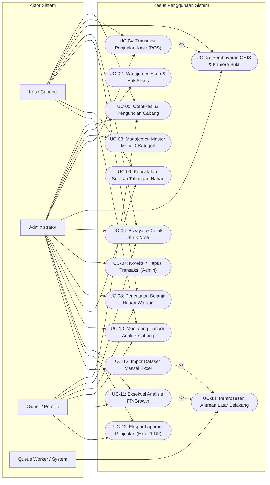

# 🎯 Use Case Diagram & Spesifikasi Kasus Penggunaan
## Analisis Interaksi Aktor & Sistem POS Kobana
### Kobana Fried Chicken

---

## 1. Definisi Aktor Sistem

1. **Kasir Cabang (*Cashier*)**:
   - Petugas garda depan yang bertugas di salah satu outlet fisik (Kobana Pusat, Sukun, atau Dinoyo).
   - Bertanggung jawab melayani pesanan pelanggan, menerima pembayaran tunai atau QRIS, memotret bukti berhasil QRIS pelanggan dengan kamera, serta mencatat belanja harian kebutuhan warung dan setoran tabungan harian.
2. **Administrator (*Store Admin*)**:
   - Pengelola operasional toko dan data master.
   - Bertanggung jawab memelihara katalog menu, kategori, akun pengguna per cabang, melakukan perbaikan data transaksi jika ada komplain, serta mengimpor dataset transaksi lampau.
3. **Pemilik Bisnis (*Owner*)**:
   - Pengambil keputusan manajerial dan pemangku kepentingan utama.
   - Memantau dasbor analitik omzet lintas 3 cabang, mengevaluasi laporan penjualan (PDF/Excel), serta menjalankan analisis asosiasi menu (*Market Basket Analysis*) dengan algoritma FP-Growth untuk perencanaan paket promosi.
4. **Pekerja Latar Belakang (*Queue Worker / System*)**:
   - Subsistem asinkron Laravel yang memproses tugas komputasi berat (penambangan pohon FP-Growth dan pemrosesan ribuan baris spreadsheet impor) tanpa membebani browser pengguna.

---

## 2. Diagram Use Case (Mermaid Diagram)

---

## 3. Matriks Keterlacakan (*Traceability Matrix*)

| ID Use Case | Nama Use Case | Aktor Terkait | Kebutuhan Fungsional (PRD) |
|---|---|---|---|
| **UC-01** | Otentikasi & Penguncian Cabang | Kasir, Admin, Owner | FR-01.1 s.d FR-01.4 |
| **UC-02** | Manajemen Akun & Hak Akses | Admin | FR-01.2, FR-01.4 |
| **UC-03** | Manajemen Master Menu & Kategori | Admin | FR-02.1 s.d FR-02.3 |
| **UC-04** | Transaksi Penjualan Kasir (POS) | Kasir, Admin | FR-03.1 s.d FR-03.4 |
| **UC-05** | Pembayaran QRIS & Kamera Bukti | Kasir, Admin | FR-04.1 s.d FR-04.4 |
| **UC-06** | Riwayat & Cetak Struk Nota | Kasir, Admin, Owner | FR-03.3, FR-04.3 |
| **UC-07** | Koreksi / Hapus Transaksi | Admin | FR-04.3 |
| **UC-08** | Pencatatan Belanja Harian Warung | Kasir, Admin, Owner | FR-05.1 s.d FR-05.4 |
| **UC-09** | Pencatatan Setoran Tabungan Harian | Kasir, Admin, Owner | FR-05.1, FR-05.2 |
| **UC-10** | Monitoring Dasbor Analitik Cabang | Kasir, Admin, Owner | FR-07.1 s.d FR-07.4 |
| **UC-11** | Eksekusi Analisis FP-Growth | Admin, Owner, Worker | FR-06.1 s.d FR-06.4 |
| **UC-12** | Ekspor Laporan Penjualan (Excel/PDF)| Admin, Owner | FR-08.1 s.d FR-08.3 |
| **UC-13** | Impor Dataset Massal Excel | Admin, Worker | FR-09.1 s.d FR-09.3 |

---

## 4. Spesifikasi Kasus Penggunaan Rinci (*Use Case Specifications*)

### UC-04: Transaksi Penjualan Kasir (POS)
- **Aktor Utama:** Kasir Cabang, Admin
- **Deskripsi:** Kasir memilih menu pesanan pelanggan, menentukan kuantitas dan diskon baris, menghitung total belanja, dan memproses transaksi.
- **Kondisi Awal (*Preconditions*):** Kasir telah login dan terikat pada outlet cabang tertentu. Menu master dalam status aktif (`is_active = 1`).
- **Kondisi Akhir (*Postconditions*):** Transaksi tersimpan secara atomik dengan kode struk unik `TRXYYYYMMDDXXXXX`, nomor urut sequence terbarui, dan kasir diarahkan ke tampilan detail nota.
- **Alur Utama (*Main Flow*):**
  1. Kasir membuka halaman *Kasir / Input Transaksi Baru*.
  2. Sistem menampilkan banner informasi cabang kasir dan daftar menu aktif beserta harga satuannya.
  3. Kasir mencari menu menggunakan kotak pencarian instan.
  4. Kasir mengisi kuantitas (`Qty`) dan diskon baris (jika ada), lalu menekan tombol **+ Tambah**.
  5. Sistem memasukkan item ke keranjang belanja dan mengalkulasi ulang *Total Item* serta *Total Bayar*.
  6. Kasir memilih metode pembayaran (Cash atau QRIS).
  7. Kasir menekan tombol **Proses & Simpan Transaksi**.
  8. Sistem memunculkan dialog konfirmasi SweetAlert2.
  9. Kasir menyetujui dialog konfirmasi.
  10. Sistem mengeksekusi *atomic transaction*, menghasilkan kode transaksi sekuensial, dan menyimpan record transaksi serta itemnya.
  11. Sistem mengarahkan kasir ke halaman rincian nota untuk dicetak.
- **Alur Alternatif (*Alternate Flows*):**
  - *Perubahan Jumlah Item*: Kasir menekan tombol `+` atau `-` pada keranjang belanja untuk mengubah kuantitas seketika.
  - *Penghapusan Item*: Kasir menekan ikon silang merah untuk membatalkan salah satu menu dari keranjang.
- **Kondisi Pengecualian (*Exceptions*):**
  - *Keranjang Kosong*: Tombol proses dinonaktifkan (`disabled`) jika belum ada menu di keranjang.
  - *Diskon Melebihi Harga*: Sistem otomatis membatasi nilai diskon maksimal sebesar `(price * qty)`.

---

### UC-05: Pembayaran QRIS & Pengambilan Foto Bukti Kamera
- **Aktor Utama:** Kasir Cabang, Admin
- **Deskripsi:** Kasir memproses transaksi non-tunai melalui QRIS dan mengambil foto langsung bukti berhasil pembayaran dari layar HP pelanggan sebagai bukti sah.
- **Kondisi Awal (*Preconditions*):** Kasir berada pada layar POS dan keranjang belanja terisi pesanan menu. Perangkat kasir memiliki webcam/kamera yang didukung browser.
- **Kondisi Akhir (*Postconditions*):** Berkas foto bukti tersimpan di `storage/app/public/payment_proofs/`, kolom `payment_proof` di tabel `transactions` terisi, dan foto tampil di kartu detail nota.
- **Alur Utama (*Main Flow*):**
  1. Kasir memilih opsi pembayaran **QRIS** pada panel POS.
  2. Sistem menyembunyikan panel tunai dan menampilkan panel QRIS beserta tombol kamera.
  3. Kasir dapat memasukkan nomor referensi / RRN QRIS pada kotak yang tersedia (opsional).
  4. Kasir menekan tombol **Buka Kamera**.
  5. Sistem meminta izin peramban dan mengaktifkan stream video langsung dari kamera perangkat (webcam PC atau kamera belakang HP).
  6. Kasir mengarahkan kamera ke layar HP pelanggan yang menampilkan notifikasi sukses QRIS.
  7. Kasir menekan tombol **Ambil Foto**.
  8. Sistem menangkap frame video ke kanvas HTML5, mengonversinya ke format gambar, dan menampilkan pratinjau kartu *Foto Siap*.
  9. Kamera otomatis dimatikan untuk menghemat daya dan memori.
  10. Kasir melanjutkan penyimpanan transaksi (sesuai UC-04).
- **Alur Alternatif (*Alternate Flows*):**
  - *Unggah Screenshot dari Galeri*: Jika pelanggan mengirimkan gambar bukti via perpesanan (WhatsApp), kasir menekan tombol **Unggah File**, memilih file gambar dari komputer/HP, dan sistem memuatnya ke kartu pratinjau.
  - *Pengambilan Ulang Foto*: Kasir menekan tombol **Hapus Foto** pada kartu pratinjau, lalu mengulangi pengambilan foto.
- **Kondisi Pengecualian (*Exceptions*):**
  - *Izin Kamera Ditolak / Tidak Ada Kamera*: Sistem menangkap exception media stream, menampilkan pesan peringatan kuning: *"Tidak dapat mengakses kamera. Silakan gunakan tombol Unggah File"*, dan mengarahkan kasir memakai tombol unggah file manual.

---

### UC-08: Pencatatan Belanja Harian Warung & Kas Kecil
- **Aktor Utama:** Kasir Cabang, Admin, Owner
- **Deskripsi:** Kasir mencatat pembelian barang kebutuhan dapur warung harian (beras, gas LPG, minyak goreng, kantong kresek, teh, gula, sabun cuci) untuk memantau perputaran kas kecil per cabang.
- **Kondisi Awal (*Preconditions*):** Kasir login dan terdaftar pada cabang tertentu.
- **Kondisi Akhir (*Postconditions*):** Transaksi kas tercatat di tabel `operational_cashes` dengan kode `KAS-YYYYMMDD-XXXX`, saldo kas cabang terbarui, dan kasir dapat mencetak bukti pengeluaran kas kecil.
- **Alur Utama (*Main Flow*):**
  1. Kasir membuka menu *Kas & Belanja Harian*.
  2. Kasir menekan tombol **+ Catat Transaksi Kas**.
  3. Kasir memilih jenis transaksi: **Pengeluaran (Belanja Operasional)**.
  4. Kasir memilih kategori belanja (misal: *Bahan Baku & Bumbu, Gas LPG, Kantong & Plastik, Sabun & Kebersihan*).
  5. Kasir mengisi nominal belanja (Rupiah) dan deskripsi kebutuhan secara jelas (contoh: *"Beli beras 10kg & minyak goreng 2L"*).
  6. Kasir dapat melampirkan foto struk pembelian fisik dari toko/pasar (opsional).
  7. Kasir menekan tombol **Simpan Transaksi Kas**.
  8. Sistem memvalidasi bahwa nominal pengeluaran tidak melebihi sisa saldo kas cabang yang tersedia.
  9. Sistem menyimpan data kas dan menyajikan pesan sukses SweetAlert2.
  10. Saldo sisa kas warung otomatis berkurang sesuai nilai belanja.
- **Alur Alternatif (*Alternate Flows*):**
  - *Pencatatan Pemasukan / Tabungan Harian*: Kasir memilih jenis **Pemasukan (Kas Masuk / Tabungan)** untuk mencatat setoran hasil penjualan harian. Saldo kas cabang otomatis bertambah.
- **Kondisi Pengecualian (*Exceptions*):**
  - *Saldo Kas Tidak Mencukupi*: Jika nominal belanja melebihi sisa kas yang tersedia di cabang tersebut, sistem membatalkan penyimpanan dan menampilkan peringatan error: *"Saldo kas cabang tidak mencukupi untuk pengeluaran ini"*.

---

### UC-11: Eksekusi Analisis Pola Keranjang Belanja (FP-Growth)
- **Aktor Utama:** Owner, Admin, Queue Worker
- **Deskripsi:** Pengguna eksekutif menjalankan data mining pada riwayat transaksi ribuan baris untuk menemukan menu yang sering dibeli bersamaan dan menghasilkan aturan rekomendasi promosi *bundling*.
- **Kondisi Awal (*Preconditions*):** Pengguna memiliki peran Owner atau Admin. Terdapat riwayat transaksi pada rentang tanggal yang dipilih.
- **Kondisi Akhir (*Postconditions*):** Struktur FP-Tree terbentuk, itemset frekuensi tinggi tersimpan di `fp_frequent_itemsets`, dan aturan asosiasi tersimpan di `fp_association_rules` lengkap dengan metrik Support, Confidence, dan Lift Ratio.
- **Alur Utama (*Main Flow*):**
  1. Pengguna membuka menu *Analisis FP-Growth*.
  2. Pengguna mengisi formulir analisis baru:
     - Judul / Nama Analisis (contoh: *"Analisis Pola Bundling Menu Q2 2026"*).
     - Rentang Tanggal Data (Dari Tanggal s.d Sampai Tanggal).
     - Ambang batas *Minimum Support* (contoh: `0.05` atau 5%).
     - Ambang batas *Minimum Confidence* (contoh: `0.50` atau 50%).
  3. Pengguna menekan tombol **Mulai Analisis**.
  4. Sistem membuat rekaman sesi dengan status `pending`, lalu mendaftarkan pekerjaan *RunFpGrowthJob* ke dalam antrean database.
  5. Sistem menampilkan notifikasi bahwa analisis sedang diproses di latar belakang.
  6. Pekerja antrean (*Queue Worker*) mengekstraksi data keranjang transaksi yang valid.
  7. Pekerja antrean menjalankan algoritma FP-Growth:
     - Menghitung frekuensi kemunculan tiap menu (1-itemset) dan mengeliminasi yang di bawah *Min Support*.
     - Mengurutkan item per transaksi berdasarkan frekuensi descending.
     - Membangun pohon *FP-Tree* dengan simpul terkompresi dan *Header Table*.
     - Melakukan penambangan rekursif *Conditional FP-Tree* untuk menemukan frequent k-itemset.
     - Menghasilkan aturan asosiasi $X \rightarrow Y$ yang memenuhi *Min Confidence*.
     - Menghitung nilai *Lift Ratio* untuk setiap aturan.
  8. Status sesi diperbarui menjadi `done` dan waktu selesai dicatat.
  9. Pengguna membuka detail hasil analisis dan melihat visualisasi tabel aturan asosiasi serta rekomendasi bundling menu.
- **Kondisi Pengecualian (*Exceptions*):**
  - *Data Transaksi Kosong*: Jika tidak ada transaksi penjualan pada rentang tanggal yang dipilih, analisis ditandai status `failed` dengan pesan: *"Tidak ada data transaksi pada periode tanggal yang dipilih"*.
  - *Tidak Ada Itemset yang Lolos Ambang Batas*: Sistem menyelesaikan analisis dengan status `done`, namun menampilkan saran kepada pengguna untuk menurunkan nilai *Minimum Support* atau *Minimum Confidence*.
