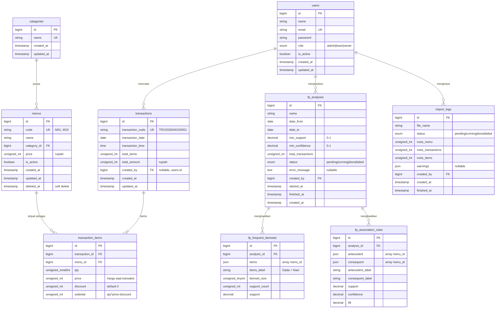

# Kobana Fried Chicken — Prompt PRD + ERD untuk AI Agent

> **Cara pakai:** salin seluruh isi dari bagian **"PROMPT UNTUK AI AGENT"** di bawah ke AI agent Anda (Claude Code, Cursor, dll.). Letakkan juga file `kobana_dataset.xlsx` di folder proyek agar agent bisa mengimpornya.

---

## Catatan hasil analisis dataset (untuk Anda)

| Sheet | Isi | Jumlah baris |
|---|---|---|
| `Master_Menu` | Kode, Menu, Kategori, Harga | 19 menu, 7 kategori |
| `Header_Transaksi` | ID, Tanggal, Hari, Jam, Total_Item, Total_Bayar | 3.230 transaksi |
| `Detail_Transaksi` | ID, Kode, Menu, Qty, Harga, Subtotal | 7.066 baris |
| `Data_FPGrowth` | Transaction_ID, Item | 7.066 baris |

Temuan penting yang sudah saya cek dan sudah dimasukkan ke prompt:

1. Periode data **1 April – 30 Juni 2026**, jam transaksi 10:00–20:59, total omzet **Rp67.232.000**.
2. `Total_Item` = jumlah `Qty` dan `Total_Bayar` = jumlah `Subtotal` per transaksi (cocok 100%).
3. **15 baris detail punya Subtotal lebih kecil dari Qty × Harga** (selisih Rp1.000, kemungkinan diskon). Karena itu ERD diberi kolom `discount`.
4. Nama menu di `Detail_Transaksi` ada yang tidak konsisten dengan master (spasi/huruf besar-kecil, mis. "French fries" vs "French Fries"; 20 baris). Karena itu detail transaksi hanya menyimpan relasi `menu_id`, bukan teks nama.
5. `Data_FPGrowth` hanyalah turunan dari detail transaksi, jadi **tidak dibuat sebagai tabel**, tetapi di-generate lewat query.
6. Format ID transaksi `TRX` + `YYYYMMDD` + 5 digit nomor urut. Nomor urut tampaknya berjalan global (tidak reset per hari).
7. Kolom `Hari` berbahasa Inggris. Di aplikasi sebaiknya dihitung dari tanggal dan ditampilkan dalam bahasa Indonesia.

---

# PROMPT UNTUK AI AGENT

## 1. Peran & tujuan

Kamu adalah senior full-stack engineer Laravel. Bangun aplikasi web **manajemen data bernama "Kobana Fried Chicken"** menggunakan **Laravel 13** (PHP sesuai requirement Laravel 13, cek dokumentasi resmi), berdasarkan dataset `kobana_dataset.xlsx` yang sudah ada.

Aplikasi ini untuk mengelola menu, mencatat dan melihat transaksi penjualan, menampilkan dashboard analitik, serta menjalankan **analisis keranjang belanja (market basket analysis) dengan algoritma FP-Growth** untuk menemukan pola menu yang sering dibeli bersamaan.

Kerjakan **per fase** (lihat bagian 11). Setelah tiap fase selesai, ringkas apa yang dibuat dan lanjut ke fase berikutnya. Jika ada keputusan yang ambigu, pilih opsi paling sederhana, tulis asumsimu di `README.md`, lalu lanjut.

## 2. Pengguna & peran

| Peran | Hak akses |
|---|---|
| **Admin** | Akses penuh: kelola user, master menu & kategori, transaksi (CRUD), impor data, analisis FP-Growth, laporan |
| **Kasir** | Input transaksi baru, lihat daftar/detail transaksi, lihat menu. Tidak boleh mengubah master data atau menghapus transaksi |
| **Owner** | Hanya baca: dashboard, laporan, hasil analisis FP-Growth (boleh menjalankan analisis). Tidak bisa mengubah data |

Terapkan lewat kolom `role` di tabel `users`, serta Gate/Policy Laravel.

## 3. Tech stack

- Laravel 13, PHP 8.3+ (sesuaikan requirement resmi), MySQL 8 / MariaDB
- Auth: autentikasi session bawaan Laravel yang dibuat manual (login, logout, ganti password) dengan view Blade sendiri. **Jangan memakai Breeze/Jetstream/Tailwind**, karena UI memakai Bootstrap via CDN
- Frontend: Blade + **Bootstrap 5 via CDN** + **SweetAlert2 via CDN** + Chart.js via CDN. **Tanpa Vite, npm, atau proses build** untuk aset frontend. UI bahasa Indonesia, responsif (mobile-friendly)
- Import/Export Excel: `phpoffice/phpspreadsheet` atau `maatwebsite/excel` (pastikan kompatibel dengan Laravel 13)
- Queue (driver `database`) untuk proses berat (impor besar & FP-Growth)
- Testing: Pest atau PHPUnit
- Timezone `Asia/Jakarta`, locale `id`, mata uang Rupiah (tanpa desimal, format `Rp 18.000`)

### Frontend via CDN (wajib)

Semua aset frontend dimuat dari CDN lewat layout utama `resources/views/layouts/app.blade.php` (dan `layouts/guest.blade.php` untuk halaman login). Jangan menambahkan Tailwind, Vite, atau npm build.

```html
<!-- di <head> -->
<link href="https://cdn.jsdelivr.net/npm/bootstrap@5.3.3/dist/css/bootstrap.min.css" rel="stylesheet">
<link href="https://cdn.jsdelivr.net/npm/bootstrap-icons@1.11.3/font/bootstrap-icons.min.css" rel="stylesheet">

<!-- sebelum </body> -->
<script src="https://cdn.jsdelivr.net/npm/bootstrap@5.3.3/dist/js/bootstrap.bundle.min.js"></script>
<script src="https://cdn.jsdelivr.net/npm/sweetalert2@11"></script>
<script src="https://cdn.jsdelivr.net/npm/chart.js@4"></script>
```

Aturan UI:

- Layout: sidebar (collapse di mobile via offcanvas) + navbar atas, konten memakai komponen Bootstrap (card, table `table-hover` dalam `table-responsive`, form dengan `is-invalid` + `invalid-feedback`, badge, pagination Bootstrap).
- Atur `Paginator::useBootstrapFive()` di `AppServiceProvider` agar pagination Laravel tampil dengan gaya Bootstrap.
- CSS/JS kustom kecil boleh ditaruh di `public/css/app.css` dan `public/js/app.js` (tanpa build step).
- **SweetAlert2 dipakai untuk semua notifikasi dan konfirmasi**, bukan `alert()`/`confirm()` bawaan browser:
  - **Notifikasi sukses/gagal:** flash message session (`success`, `error`, `warning`) ditampilkan sebagai toast SweetAlert2 (`toast: true`, posisi `top-end`, timer 3 detik) lewat satu partial `partials/swal.blade.php` yang di-include di layout.
  - **Konfirmasi hapus:** semua tombol hapus (menu, kategori, transaksi, user, riwayat analisis) memakai form `DELETE` dengan atribut `data-confirm`; satu skrip global menampilkan dialog "Yakin ingin menghapus?" (ikon `warning`, tombol "Ya, hapus" merah dan "Batal"), form baru dikirim jika dikonfirmasi.
  - **Konfirmasi aksi penting lain:** jalankan analisis FP-Growth, mulai impor data, logout, nonaktifkan user/menu.
  - **Loading state:** tampilkan `Swal.fire` dengan `didOpen: () => Swal.showLoading()` saat impor/analisis dimulai, dan tutup ketika selesai.
  - **Error validasi form:** tetap tampil inline di bawah field (Bootstrap), ditambah toast ringkas "Periksa kembali isian Anda".
  - Seluruh teks dialog berbahasa Indonesia.

## 4. Skema database (ERD)



### Aturan skema

- **Rupiah disimpan sebagai integer** (`unsignedInteger`), bukan float/decimal.
- `transactions.total_items` = SUM(`transaction_items.qty`); `transactions.total_amount` = SUM(`transaction_items.subtotal`). Dihitung di server, jangan percaya input client.
- `transaction_items.price` adalah snapshot harga saat transaksi (agar perubahan harga menu tidak mengubah histori).
- `transaction_items.discount` = `qty * price - subtotal` untuk data impor (di dataset ada 15 baris dengan selisih Rp1.000).
- Unique index `(transaction_id, menu_id)` pada `transaction_items` (di dataset tidak ada menu duplikat dalam satu transaksi).
- Index tambahan: `transactions.transaction_date`, `transaction_items.menu_id`, `menus.category_id`.
- Foreign key `restrictOnDelete` untuk `menus` → `transaction_items`. Menu yang sudah pernah terjual hanya boleh dinonaktifkan (`is_active = false`) atau soft delete, tidak dihapus permanen.
- Nama hari **tidak disimpan**; hitung dari `transaction_date` dan tampilkan dalam bahasa Indonesia (Senin, Selasa, ...).
- Sheet `Data_FPGrowth` **tidak dibuat sebagai tabel**; basket FP-Growth dibangun lewat query dari `transaction_items`.

## 5. Impor dataset

Buat Artisan command `php artisan kobana:import {path=database/data/kobana_dataset.xlsx}` dan halaman **Impor Data** (khusus Admin, upload `.xlsx`, diproses via queue, progres tercatat di `import_logs`).

Aturan impor:

1. Baca sheet `Master_Menu` → isi `categories` (unik dari kolom `Kategori`) dan `menus` (`Kode` → `code`).
2. Baca `Header_Transaksi` → `transactions`. Pisahkan `Jam` ke `transaction_time`, abaikan kolom `Hari`.
3. Baca `Detail_Transaksi` → `transaction_items`. Petakan menu **berdasarkan `Kode`**, abaikan teks kolom `Menu` (ada ketidakkonsistenan huruf besar/kecil dan spasi). Hitung `discount = Qty*Harga - Subtotal`.
4. Sheet `Data_FPGrowth` **diabaikan** (turunan).
5. Proses idempoten: jalankan ulang tidak boleh menggandakan data (`updateOrCreate` berdasarkan `code` / `transaction_code`).
6. Gunakan chunk (mis. 500 baris) dan database transaction.
7. Validasi rekonsiliasi setelah impor dan catat hasilnya di `import_logs.warnings`:
   - `total_items` header = SUM(qty) detail
   - `total_amount` header = SUM(subtotal) detail
   - Setiap `Kode` di detail ada di master menu
8. Ekspektasi hasil dari dataset ini: **19 menu, 7 kategori, 3.230 transaksi, 7.066 item transaksi, total omzet Rp67.232.000**.

## 6. Fitur (functional requirements)

### FR-1 Autentikasi & manajemen user
- Login/logout, ganti password, proteksi route berdasarkan role.
- Admin: CRUD user, ubah role, aktif/nonaktif user.

### FR-2 Master Kategori & Menu
- CRUD kategori dan menu (kode unik, nama, kategori, harga, status aktif).
- Daftar menu: pencarian, filter kategori & status, pagination, urut kolom.
- Menu yang sudah punya transaksi tidak bisa dihapus permanen (hanya nonaktifkan).

### FR-3 Transaksi
- **Daftar transaksi**: filter rentang tanggal, jam, menu, kategori, rentang total; pencarian kode transaksi; pagination; kolom hari (bahasa Indonesia).
- **Detail transaksi**: header + daftar item.
- **Input transaksi baru** (Admin & Kasir): pilih menu (hanya yang aktif), qty, diskon opsional; total dihitung otomatis; harga diambil dari master menu; simpan dalam satu database transaction.
- **Kode transaksi otomatis** format `TRX` + `YYYYMMDD` + 5 digit nomor urut; gunakan locking agar tidak ada kode ganda saat input bersamaan.
- Edit dan hapus transaksi: hanya Admin, hapus wajib lewat konfirmasi SweetAlert2.

### FR-4 Dashboard
Filter periode (default: seluruh data), kartu ringkasan dan grafik:
- Total omzet, jumlah transaksi, total item terjual, rata-rata nilai per transaksi
- Tren omzet & jumlah transaksi per hari / minggu / bulan (line chart)
- Penjualan per jam (10:00–20:59) dan per hari dalam seminggu (bar chart)
- Top 10 menu terlaris (qty & omzet)
- Komposisi penjualan per kategori (donut/bar)
- Gunakan query agregat di database (`GROUP BY`), bukan memuat semua baris ke memori. Cache hasil agregat singkat (mis. 5 menit) dan invalidasi saat data berubah.

### FR-5 Analisis FP-Growth (Market Basket)
- Halaman **Analisis FP-Growth**: form parameter `min_support` (default 0.02), `min_confidence` (default 0.3), rentang tanggal; tombol "Jalankan Analisis".
- Implementasi algoritma sebagai service class murni PHP (`App\Services\FpGrowth`) yang terpisah dari controller:
  - Input: basket = himpunan `menu_id` unik per transaksi (dari `transaction_items`).
  - Bangun FP-Tree, hitung frequent itemsets, lalu association rules.
  - Metrik rule: **support, confidence, lift**.
  - Proses lewat queue job; status `pending → running → done/failed` tersimpan di `fp_analyses`.
- Hasil disimpan di `fp_frequent_itemsets` dan `fp_association_rules`.
- Tampilan hasil: tabel frequent itemsets, tabel rules (urut lift/confidence, filter lift > 1, pencarian menu), ringkasan insight otomatis (contoh: "Pembeli Dada cenderung membeli Nasi, confidence 42%, lift 1,6"), ekspor ke Excel.
- Riwayat analisis: daftar analisis sebelumnya beserta parameternya, bisa dibuka ulang atau dihapus (Admin).
- Wajib ada unit test untuk `FpGrowth` dengan dataset kecil yang hasilnya bisa dihitung manual (support, confidence, lift diverifikasi).

### FR-6 Laporan & ekspor
- Laporan penjualan harian/bulanan, penjualan per menu, penjualan per kategori.
- Ekspor ke Excel dan PDF dengan filter periode.

### FR-7 Impor data
- Sesuai bagian 5. Tampilkan riwayat impor dan peringatan rekonsiliasi.

## 7. Kebutuhan non-fungsional

- **Keamanan:** validasi lewat Form Request, proteksi CSRF, mass-assignment guard, authorization via Policy, rate limit pada login, hash password bawaan Laravel.
- **Performa:** daftar dan laporan wajib server-side pagination dan eager loading (hindari N+1). Halaman dashboard < 2 detik untuk ±3.000 transaksi.
- **Integritas data:** foreign key, unique constraint, DB transaction pada operasi multi-tabel.
- **Kualitas kode:** struktur Laravel standar (Controller tipis, logika bisnis di Service/Action class, Eloquent API Resource/DTO jika perlu), PSR-12, Laravel Pint.
- **UX:** pesan error/sukses berbahasa Indonesia lewat SweetAlert2 (toast dan dialog konfirmasi), konfirmasi sebelum hapus, state kosong yang informatif, tampilan Bootstrap 5 yang konsisten dan responsif.

## 8. Rancangan halaman

| Route | Halaman | Role |
|---|---|---|
| `/login` | Login | Semua |
| `/dashboard` | Dashboard | Semua |
| `/menus`, `/categories` | Master menu & kategori | Admin (CRUD), Kasir/Owner (lihat) |
| `/transactions` | Daftar & detail transaksi | Semua (lihat) |
| `/transactions/create` | Input transaksi | Admin, Kasir |
| `/analysis/fp-growth` | Analisis FP-Growth & riwayat | Admin, Owner |
| `/reports` | Laporan & ekspor | Admin, Owner |
| `/imports` | Impor data | Admin |
| `/users` | Manajemen user | Admin |

## 9. Seeder awal

- Admin: `admin@kobana.test` / password acak yang dicetak di console saat seeding (jangan hardcode di repo).
- Contoh user Kasir dan Owner.
- Jalankan `kobana:import` dari `DatabaseSeeder` (opsional via flag) agar data siap dipakai.

## 10. Kriteria penerimaan (acceptance criteria)

1. Setelah `php artisan migrate --seed` + impor, jumlah data = 19 menu, 7 kategori, 3.230 transaksi, 7.066 item transaksi; total omzet = Rp67.232.000.
2. Impor dijalankan dua kali tidak mengubah jumlah data (idempoten).
3. Kasir tidak dapat membuka halaman master data/impor/user (HTTP 403); Owner tidak dapat mengubah data.
4. Transaksi baru yang disimpan memiliki total yang dihitung server dan kode unik berformat benar.
5. Dashboard menampilkan angka yang sama dengan hasil query langsung ke database.
6. Analisis FP-Growth selesai pada dataset penuh tanpa timeout, hasil rules menampilkan support, confidence, lift, dan test unit algoritma lulus.
7. Seluruh test otomatis lulus (`php artisan test`).
8. Aplikasi berjalan tanpa `npm install` / `npm run build`; Bootstrap, SweetAlert2, dan Chart.js dimuat dari CDN.
9. Semua aksi hapus menampilkan dialog konfirmasi SweetAlert2, dan semua notifikasi sukses/gagal tampil sebagai toast SweetAlert2 (tidak ada `alert()`/`confirm()` bawaan browser).

## 11. Fase pengerjaan (kerjakan berurutan)

1. **Setup:** proyek Laravel 13, konfigurasi `.env`, timezone/locale, queue database, layout Blade dengan Bootstrap 5 + SweetAlert2 + Chart.js via CDN (partial toast dan konfirmasi hapus global), pagination Bootstrap.
2. **Database:** migration, model + relasi, factory, seeder sesuai bagian 4 dan 9.
3. **Impor:** command + halaman impor + rekonsiliasi (bagian 5).
4. **Auth & role:** halaman login dan logout manual (Bootstrap), role, Gate/Policy, manajemen user.
5. **Master data:** CRUD kategori & menu.
6. **Transaksi:** daftar, filter, detail, input, edit/hapus.
7. **Dashboard:** agregasi dan grafik.
8. **FP-Growth:** service, job, halaman hasil, unit test.
9. **Laporan & ekspor.**
10. **Finishing:** test, Pint, `README.md` (instalasi, asumsi, cara impor, akun demo).

**Mulai dari Fase 1.** Jangan lanjut ke fase berikutnya sebelum fase saat ini berjalan tanpa error.
